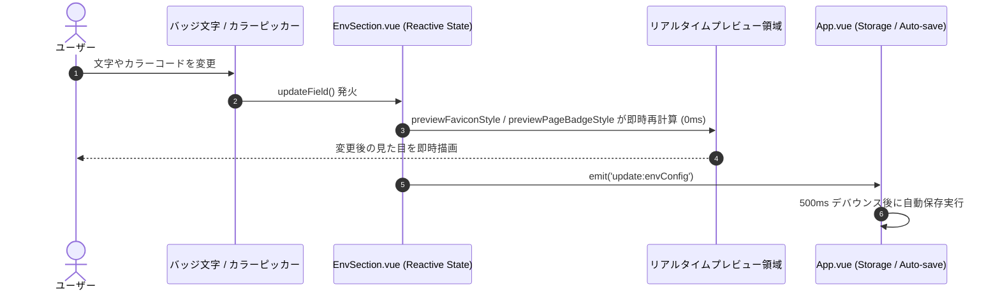
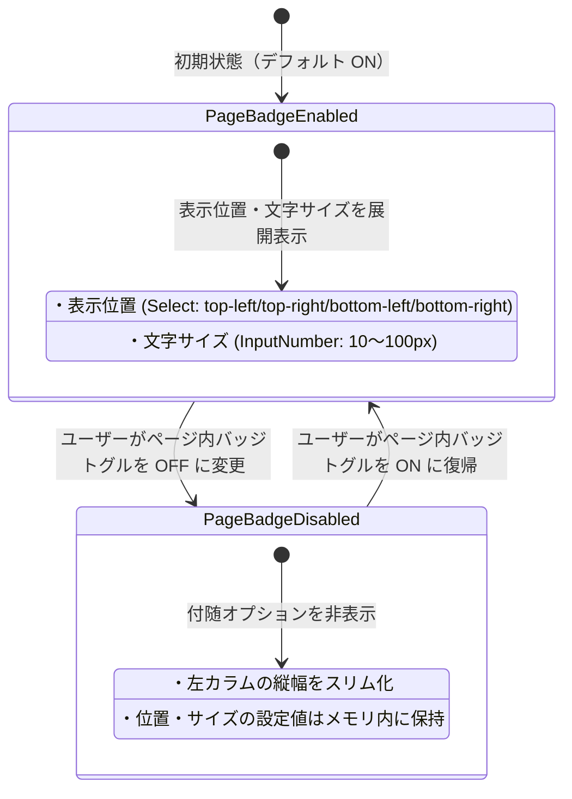

# データモデルおよびUI状態設計書 (Data Model & State Design): オプション設定画面のUIレイアウト刷新

**Branch**: `003-options-ui-redesign` | **Date**: 2026-11-13 | **Spec**: [spec.md](./spec.md)

本ドキュメントは、オプション設定画面のUIレイアウト刷新におけるデータモデル、コンポーネントのProps/State、およびリアクティブな算出状態を定義します。

---

## 1. 永続化データモデル (Persistent Entities)

本機能において、Chrome Storage（`chrome.storage.sync`）へ永続化されるデータ構造の破壊的変更や新規フィールド追加はありません。既存の `src/types.ts` で定義されているインターフェースをそのまま維持・活用します。

### 1.1 `EnvironmentConfig` (環境設定エンティティ)

```typescript
export interface EnvironmentConfig {
  /** 環境識別子 ("prod" | "stg" | "dev" | "custom_<timestamp>") */
  id: string;
  /** 表示名 (例: "Production", "QA") */
  name: string;
  /** バッジに表示する文字列（最大4文字） */
  badgeText: string;
  /** バッジの文字色（有効なHEX文字列、例: "#ff0000"） */
  badgeColor: string;
  /** バッジのフチドリ色（有効なHEX文字列、例: "#ffffff"） */
  badgeOutlineColor: string;
  /** Favicon書き換えの有効/無効フラグ（デフォルト: true） */
  faviconEnabled?: boolean;
  /** ページ内バッジ表示の有効/無効フラグ（デフォルト: true） */
  pageBadgeEnabled?: boolean;
  /** コンソールログ出力の有効/無効フラグ（デフォルト: true） */
  consoleLogEnabled?: boolean;
  /** ページ内バッジの表示位置 ('top-left' | 'top-right' | 'bottom-left' | 'bottom-right') */
  pageBadgePosition?: PageBadgePosition;
  /** ページ内バッジの文字サイズ（px、10〜100） */
  pageBadgeFontSize?: number;
  /** ホスト名・URLパターンの配列 */
  hostnames: HostnamePattern[];
  /** ユーザーが削除可能かどうか（PROD/STG/DEVは false） */
  isDeletable: boolean;
}
```

### 1.2 `HostnamePattern` (ホスト名・URLパターンエンティティ)

```typescript
export interface HostnamePattern {
  /** 正規化済みURLパターン文字列（hostname[:port][/path]）または正規表現文字列 */
  value: string;
  /** 正規表現として評価するかどうか */
  isRegex: boolean;
  /** パターンが有効かどうか（デフォルト: true） */
  enabled?: boolean;
}
```

---

## 2. オプション画面 UI 状態モデル (Component UI State)

### 2.1 `EnvSection.vue` の状態モデル

環境カードコンポーネントが管理・算出するUI状態です。

| 状態名 / 算出プロパティ | 型 | 役割 / 算出ロジック |
| :--- | :--- | :--- |
| `isDefaultEnv` | `boolean` | `['prod', 'stg', 'dev'].includes(props.envConfig.id)`。デフォルト環境判定。 |
| `defaultEnvTitle` | `string` | デフォルト環境の場合のローカライズ済みタイトル文字列。 |
| `previewBadgeText` | `string` | プレビュー表示用テキスト。`envConfig.badgeText` が空の場合は環境IDまたはデフォルト文字にフォールバック。大文字化表示。 |
| `previewFaviconStyle` | `CSSProperties` | Favicon調プレビューの文字色・フチドリ（`text-shadow`）スタイルオブジェクト。 |
| `previewPageBadgeStyle` | `CSSProperties` | ページ内バッジ調プレビューの半透明背景・文字色・輪郭シャドウスタイルオブジェクト。 |
| `rulesCountLabel` | `string` | 登録パターン数に応じた多言語表記ラベル（単数・複数形を考慮、例: `3 rules` / `3件のルール`）。 |
| `isPageBadgeVisible` | `boolean` | `envConfig.pageBadgeEnabled !== false`。位置・フォントサイズ設定ブロックの表示制御フラグ。 |

### 2.2 `HostnameList.vue` の状態モデル

右カラムのURLパターン一覧コンポーネントが管理するUI状態です。

| 状態名 / 算出プロパティ | 型 | 役割 / 算出ロジック |
| :--- | :--- | :--- |
| `draggingIndex` | `number \| null` | 現在ドラッグ中の行インデックス（並び替え用）。 |
| `dragOverIndex` | `number \| null` | ドラッグ要素が重なっている行インデックス。 |
| `isMatchedRow(index)` | `boolean` | URLチェッカーで採用された行かどうか（`.match-success` スタイル適用）。 |
| `isInvalidRow(index)` | `boolean` | バリデーションエラー行かどうか（`.p-invalid` スタイル適用）。 |

---

## 3. 状態遷移と連動フロー (State Transitions)

### 3.1 リアルタイムプレビュー更新フロー



### 3.2 ページ内バッジトグルによるスマート連動フロー


